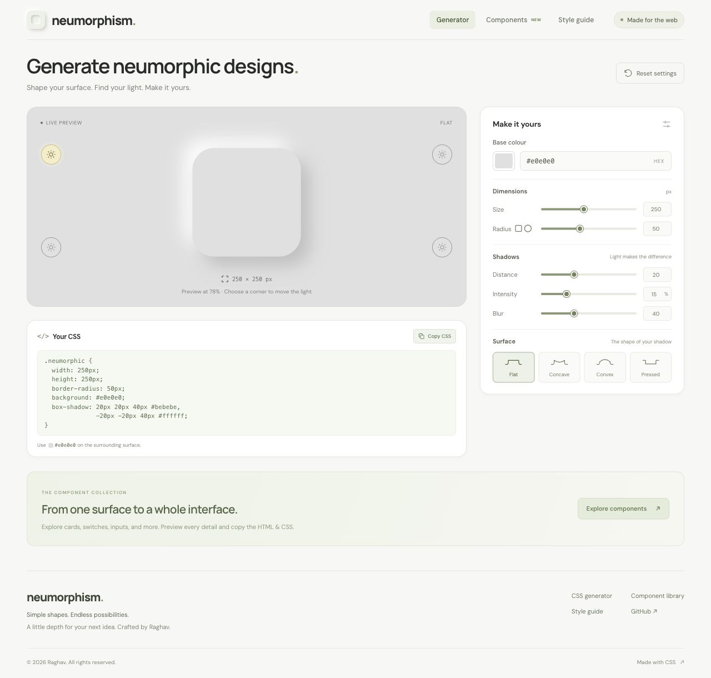
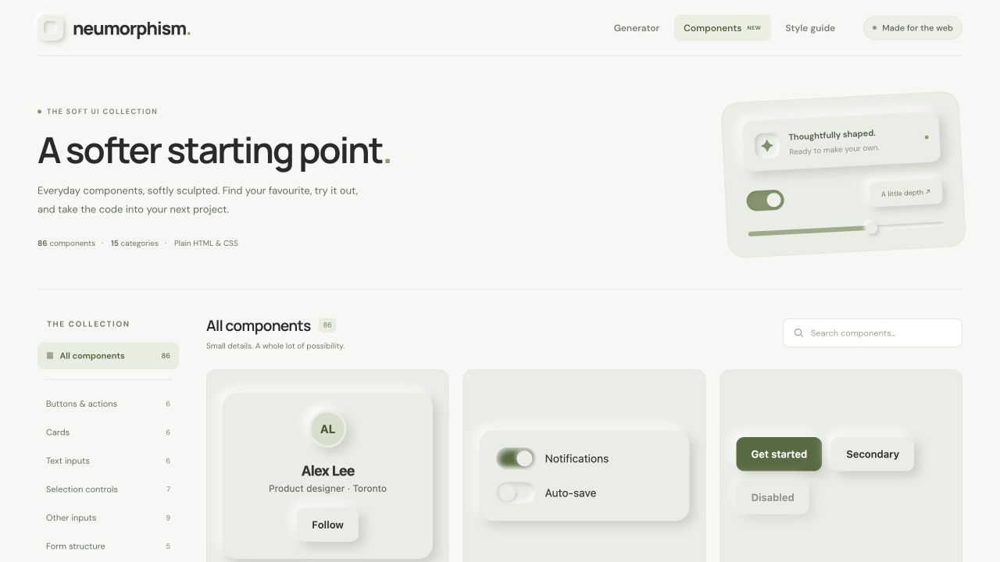
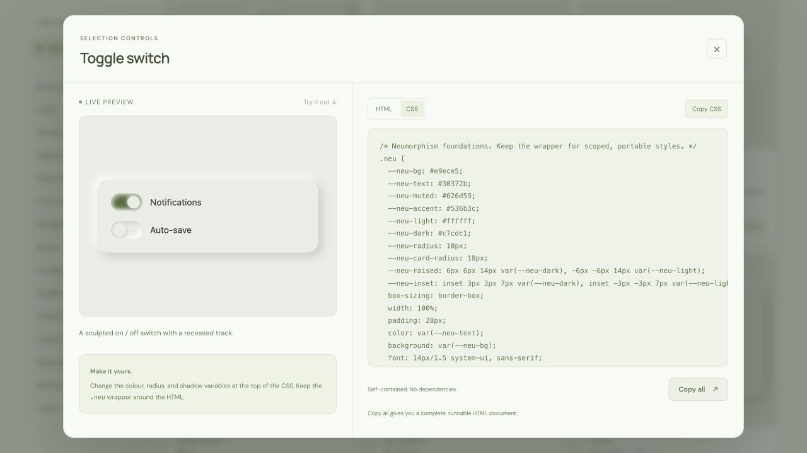
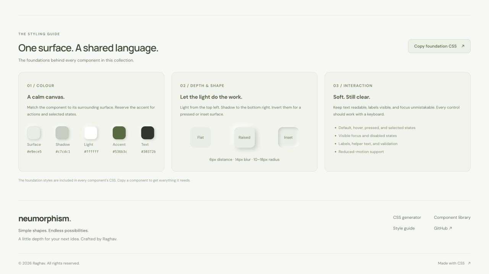

# Neumorphism Generator

A CSS generator, interactive component library, and styling guide for building
soft, tactile web interfaces. Experiment with light and shadow, explore
**86 components across 15 categories**, and copy the code into your own project.

Neumorphism gives controls a raised or pressed appearance by combining a surface
colour with opposing light and dark shadows. This project helps you explore that
style through live previews, adjustable surfaces, and reusable interface patterns.
The app runs in your browser with no backend or account required. Exported
components use plain HTML, CSS, and vanilla JavaScript where needed, so they can
be used independently of the React app.



[Getting started](#getting-started) · [CSS generator](#css-generator) ·
[Component library](#component-library) · [Copying components](#copying-components) ·
[Styling guide](#styling-guide)

## CSS generator

Start with a single surface and adjust its appearance while the preview and CSS
update together. Use it to explore a design direction or generate the shadows
for your own cards, buttons, and panels.

- Flat, concave, convex, and pressed surfaces.
- Four light-source positions, selectable from the preview corners.
- Colour picker and validated 3 or 6 digit hex input.
- Sliders and numeric inputs for size, radius, distance, intensity, and blur.
- Square and circle geometry shortcuts, plus a full settings reset.
- Live CSS output with clipboard feedback and selectable text for manual copying.
- Responsive preview scaling that preserves exported pixel dimensions.
- Colour links such as `/#e0e0e0`; the hash stores the base colour only.

Use the selected base colour on the surrounding surface when applying the CSS.
At pure black or white, highlights or shadows can disappear as colour channels
reach their limits.

## Component library

Browse the collection from **Components** in the navigation. Search by name, description, or category,
filter the collection, and load additional previews on demand. The layout adapts
to a category selector on smaller screens, and each preview lets you try the
component before opening its code.



The collection includes:

| Component group | Examples |
| --- | --- |
| Buttons and cards | Buttons, icon buttons, button groups, profile cards, product cards, pricing cards |
| Forms and inputs | Text fields, search, checkboxes, radio buttons, switches, sliders, date pickers, file uploads |
| Navigation and menus | Navigation bars, sidebars, tabs, breadcrumbs, pagination, dropdowns, account menus |
| Overlays and feedback | Dialogs, drawers, popovers, tooltips, alerts, toasts, empty states |
| Content and data | Accordions, carousels, lists, tables, sortable tables, timelines, tree views |
| Status, identity, and layout | Progress indicators, skeletons, avatars, chips, grids, stacks, surface panels |

Link directly to a component with `/neumorphism-generator/components/?component=toggle-switch`.
Shared navigation connects the generator, library, and styling guide, while the
footer includes project attribution and a link to the source repository.

## Copying components

Open **View code** on any component to see its live preview beside the source.
The preview and export use the same markup, styles, and behaviour.



1. Copy the **HTML**, keeping the `.neu` wrapper around the component.
2. Copy the **CSS** into your stylesheet. Each export includes the foundation
   styles and variables it needs.
3. If a **JavaScript** tab is present, include that code for the component's
   interactions. Place it after the markup or run it once the DOM is ready.
4. Alternatively, choose **Copy all** to get a complete, runnable HTML document
   with its styles and any interaction script included.

Customise the surface colour, accent, radius, and shadow variables in the CSS to
match your project. Exported examples do not require React, a component package,
or a build tool. App-specific actions such as checkout or creating a project are
presentation examples to connect to your own application.

## Styling guide

The guide at `/neumorphism-generator/components/#style-guide` explains the design language shared by
all the examples:

- **Colour:** matching surfaces, readable text, and a restrained accent palette.
- **Depth and shape:** consistent lighting, opposing shadows, raised and inset
  surfaces, and rounded corners.
- **Interaction:** hover, pressed, selected, focus, and disabled states, plus
  labels, validation, keyboard access, and reduced-motion support.

Its foundation CSS is copyable and is already included in every component's
CSS export.



## Getting started

Use Node.js 24.15 or newer in the Node 24 release line (`nvm install` and
`nvm use` read `.nvmrc`). Node 22.22.2+ and Node 26+ are also supported.

```sh
npm ci
npm start
```

Open the local URL printed by Vite, usually http://localhost:5173/neumorphism-generator/.

| Page | Route |
| --- | --- |
| CSS generator | `/neumorphism-generator/` |
| Component library | `/neumorphism-generator/components/` |
| Styling guide | `/neumorphism-generator/components/#style-guide` |

## Built with

- **React 19** for the application interface and state.
- **Vite 8** for local development and production builds.
- **Plain CSS** for application styling and exported component styles.
- **Jest and React Testing Library** for automated checks.

The generator and library run entirely in the browser. No backend is needed.

## Commands

| Command | Purpose |
| --- | --- |
| `npm start` / `npm run dev` | Start Vite with hot module replacement |
| `npm run build` | Build the production app into `dist/` |
| `npm run preview` | Preview the production build locally |
| `npm run deploy` | Build and publish the app to the `gh-pages` branch |
| `npm run lint` | Check JavaScript, React Hooks, and Fast Refresh rules |
| `npm test` | Run Jest and React Testing Library tests |
| `npm run test:watch` | Run Jest in watch mode |
| `npm run test:coverage` | Run tests and generate HTML/LCOV coverage |

## Development

The app uses React's `createRoot` API and Strict Mode. Components, their styles,
and their dedicated test files live together:

```text
src/
  components/
    common/       # ColourPicker and RangeControl
    generator/    # Creator composition, controls, preview, and CSS output
    layout/       # Site header and footer
    library/      # Collection, isolated previews, code viewer, and styling guide
  hooks/          # Settings/URL synchronization, preview sizing, clipboard
  lib/            # Settings, CSS generation, component catalogue, and export styles
  styles/         # Shared panel and section styles
  test/           # Test-only CSS and ResizeObserver helpers
  App.jsx         # Application root
  index.css       # Global reset, fonts, focus, and accessibility utilities
  main.jsx        # Browser entry point
```

`useGeneratorSettings` owns settings and synchronizes the base colour with the
URL hash, preserving the route, query parameters, and history state. Resetting
starts a new editing session so unfinished input drafts are cleared as well.
`src/lib/generatorSettings.js` defines defaults, limits, and validated updates.
`src/lib/neumorphism.js` generates the same style values used by both the preview
and CSS output. No backend is needed.

Changing distance also sets blur to twice the distance. Blur can then be
adjusted independently. Intensity is displayed as a percentage. Numeric inputs
commit on blur or Enter and clamp to their allowed bounds. Escape cancels a
pending edit. Radius is capped at half the size, including half-pixel radii for
odd-sized circles. Invalid hex input leaves the last valid preview intact.

Static layout and appearance belong in the component CSS files. Inline values
are limited to the generated surface styles and dynamic CSS custom properties
for canvas colours, swatches, slider progress, and preview scaling. There is no
CSS-in-JS dependency. The UI uses Google Fonts with system-font fallbacks.

### Adding components

The catalogue lives in `src/lib/componentCatalog.js`. Add an entry to the
appropriate category with its markup, optional component CSS, optional vanilla
JavaScript, and preview height. Shared styles live in
`src/lib/componentStyles.js`.

The document builder renders each preview and creates its standalone export.
Previews run in sandboxed frames to isolate their markup, CSS, and behaviour.
Copied interaction scripts are scoped to their component wrappers so different
examples can coexist on the same page.

### GitHub Pages deployment

The app is configured for this project URL:

[https://raghavbud1597.github.io/neumorphism-generator/](https://raghavbud1597.github.io/neumorphism-generator/)

With dependencies installed and Git authenticated for the `origin` repository,
run:

```sh
npm run deploy
```

The `predeploy` script builds the app. Vite uses `/neumorphism-generator/` as its
base path, and `postbuild` creates `dist/components/index.html` so the library
and its deep links work on a static host. The `gh-pages` package publishes the
contents of `dist/` to the remote `gh-pages` branch and adds `.nojekyll`.
Publishing the build does not commit changes on your current source branch.

For the first deployment, open the repository's
[Pages settings](https://github.com/raghavbud1597/neumorphism-generator/settings/pages)
after publishing the branch:

1. Under **Build and deployment**, set **Source** to **Deploy from a branch**.
2. Select the **gh-pages** branch and **/ (root)** folder.
3. Save and wait for GitHub's Pages deployment to finish.

For subsequent updates, run `npm run deploy` again. Use `npm run build` followed
by `npm run preview` to check the production build locally before publishing.
The component library is available at
`/neumorphism-generator/components/`, and the styling guide is at
`/neumorphism-generator/components/#style-guide`.

If you rename or fork the repository, update `base` in `vite.config.js` and
`homepage` in `package.json` to match your Pages URL. To host at a domain root,
set Vite's `base` to `/`. The generated library entry means no SPA fallback or
custom 404 redirect is required for the existing pages.

See the [Vite deployment guide](https://vite.dev/guide/static-deploy#github-pages)
and [gh-pages documentation](https://github.com/tschaub/gh-pages) for configuration
options.

### Screenshots

The screenshots in this README are stored in `docs/screenshots/` so they remain
available when the repository is cloned or viewed on GitHub. Capture them from
the running app when updating the interface, and keep filenames and image links
in sync.

## Testing

Jest runs independently of Vite, using Babel only to transform JSX and jsdom for
the DOM environment. The npm scripts enable native ESM so tests can use the
same ES modules as the application, including the ESM-only colour library.
Node may print an experimental VM Modules notice; the flag follows the
[Jest ESM setup](https://jestjs.io/docs/ecmascript-modules).

Colocated tests cover the generator, library, code viewer, navigation, and styling
guide. The generator suite also exercises the complete workflow in Strict Mode.
Every catalogue export is checked as a standalone document, including ID
references, complete CSS, and dependency-free script initialization. Tests use
React Testing Library roles and labels, user-event interactions, and focused
assertions; application children are rendered without component mocks or snapshots.

Coverage includes every component, hook, and library module. Only the browser
bootstrap, test setup, and test helpers are excluded. Thresholds enforce 90%
statements, lines, and functions, and 85% branches. The HTML report is written
to `coverage/index.html`. ResizeObserver sizing and clipboard failures are
covered with browser API mocks. CSS is stubbed in unit tests; inspect responsive
layouts in a real browser when changing styles.

```sh
npm test
npm run test:coverage
npm run lint
npm run build
```

Use npm and commit `package-lock.json` when dependencies change. Dependencies,
build output, coverage, and local environment files are ignored by Git.
Install dependencies with `npm ci` after cloning; `node_modules` is not tracked.
